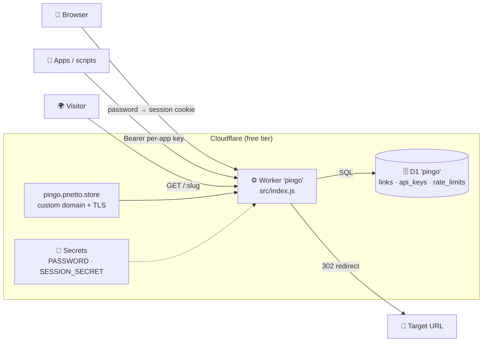

# 🤏 pingo

Tiny URL shortener on Cloudflare Workers + D1 (free tier) at **https://pingo.pnetto.store**.

- Browser: open the site, enter the password, shorten links (copied to clipboard automatically).
- API: create one key per app in the **keys** tab, then send `Authorization: Bearer <key>` (or `x-api-key`).
  Keys only see/delete links they created. Keys are stored as SHA-256 hashes and shown once.

Agents: point them at **https://pingo.pnetto.store/llms.txt** (agent-friendly manual, source in `src/docs.js`).

## Architecture



## API

```bash
K=pingo_xxx   # from the keys tab
# create (slug optional; scheme optional)
curl -X POST https://pingo.pnetto.store/api/links -H "Authorization: Bearer $K" \
  -H 'content-type: application/json' -d '{"url":"https://example.com","slug":"ex"}'
# → {"slug":"ex","url":"https://example.com/","short":"https://pingo.pnetto.store/ex","clicks":0,"created_at":...}

curl https://pingo.pnetto.store/api/links      -H "Authorization: Bearer $K"   # list (latest 500)
curl https://pingo.pnetto.store/api/links/ex   -H "Authorization: Bearer $K"   # get one
curl -X DELETE https://pingo.pnetto.store/api/links/ex -H "Authorization: Bearer $K"
```

Errors: `400` invalid url/slug, `401` bad key, `404` not found, `409` slug taken, `429` rate limited (see `Retry-After`).

### Frontend apps (CORS)

Give a key a list of **frontend domains** (keys tab → 🌐, or `origins` in the API) and browsers on those
sites can call `/api/links*` and `/api/me` directly. Keys without domains are **server-only**: any browser
request with them is rejected, so a leaked server key can't be used from a web page.

- Formats: `myapp.com` (→ https), `https://*.vercel.app` (subdomains), `localhost:5173` (→ http).
- ⚠️ A key in frontend code is public. Domains stop *other websites* from using it in a browser, but not
  someone copying it into a script. Rate limits cap the damage; rotate it if abused.

```js
await fetch("https://pingo.pnetto.store/api/links", {
  method: "POST",
  headers: { authorization: "Bearer pingo_xxx", "content-type": "application/json" },
  body: JSON.stringify({ url: "https://example.com" }),
}).then((r) => r.json()); // → { short: "https://pingo.pnetto.store/ab3de", ... }
```

Key management (`/api/keys`, browser session only): `GET` list, `POST {name, origins?}` create, `PATCH /:id {name?, origins?}` edit, `POST /:id/rotate` new secret, `DELETE /:id`. `origins` is an array or comma-separated string; empty = server-only.

## Rate limits

| What | Limit | Where |
|---|---|---|
| Login attempts | 10 / IP / 15 min | D1 (exact) |
| Failed logins, all IPs | 30 / hour, then login pauses | D1 (exact) |
| Create links | 30 / min + 1000 / day per caller | binding + D1 |
| Key changes | 30 / hour | D1 (exact) |
| Any API call | 120 / min per caller | binding |
| Bad/missing key | 20 / min / IP | binding |
| Redirects | 120 / min / IP | binding |

"binding" = Workers Rate Limiting (approximate, per Cloudflare location).

## Ops

```bash
npm i
npx wrangler secret put PASSWORD        # browser password
npx wrangler secret put SESSION_SECRET  # rotate to log out all browsers
npm run deploy
npm run db:migrate                      # apply migrations/
```
