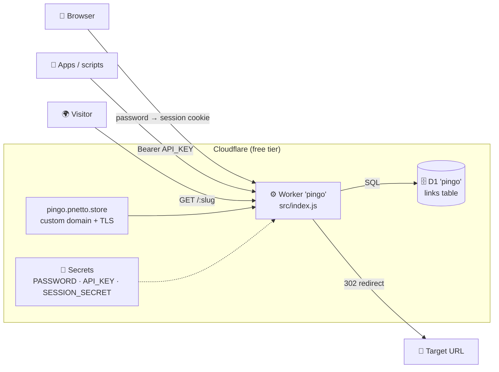

# 🐧 pingo

Tiny URL shortener on Cloudflare Workers + D1 (free tier) at **https://pingo.pnetto.store**.

- Browser: open the site, enter the password, shorten links (copied to clipboard automatically).
- API: send `Authorization: Bearer <API_KEY>` (or `x-api-key: <API_KEY>`).

## Architecture



## API

```bash
K=pingo_xxx
# create (slug optional; scheme optional)
curl -X POST https://pingo.pnetto.store/api/links -H "Authorization: Bearer $K" \
  -H 'content-type: application/json' -d '{"url":"https://example.com","slug":"ex"}'
# → {"slug":"ex","url":"https://example.com/","short":"https://pingo.pnetto.store/ex","clicks":0,"created_at":...}

curl https://pingo.pnetto.store/api/links      -H "Authorization: Bearer $K"   # list (latest 500)
curl https://pingo.pnetto.store/api/links/ex   -H "Authorization: Bearer $K"   # get one
curl -X DELETE https://pingo.pnetto.store/api/links/ex -H "Authorization: Bearer $K"
```

Errors: `400` invalid url/slug, `401` bad key, `404` not found, `409` slug taken.

## Ops

```bash
npm i
npx wrangler secret put PASSWORD        # browser password
npx wrangler secret put API_KEY         # API key
npx wrangler secret put SESSION_SECRET  # rotate to log out all browsers
npm run deploy
npm run db:init                         # create schema (idempotent)
```
